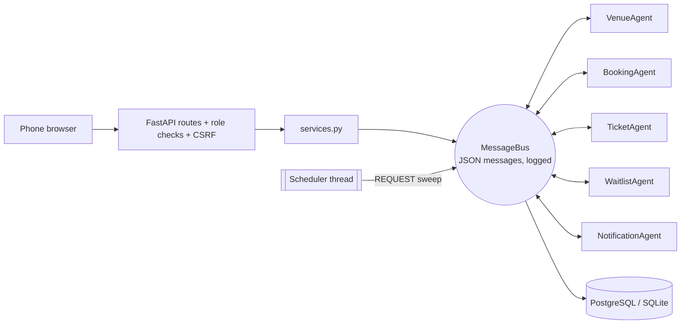

# EventSphere

Mobile-friendly **venue booking and digital ticketing platform** in which every booking decision is made by
**five cooperating software agents** that talk only through structured JSON messages.

Built for *IT4123 Agent Based Computing Practical – ICA 02* · Python 3.11+, FastAPI, Pydantic, PostgreSQL/SQLite, Bootstrap, Pytest.

> **Live demo:** `<PUT YOUR RENDER URL HERE>` &nbsp;|&nbsp; Free hosting sleeps – open the link once and wait ~1 minute.

## Features

| Area | What you can do |
|---|---|
| Attendee | Register / sign in, search + filter events, book tickets, simulated payment, QR tickets on the phone, cancel with refund, join waitlists (timed holds with countdown), request private venue hire |
| Gate staff | Camera QR scanner (manual code fallback); clear ADMIT / REJECT reasons |
| Admin / organiser | Venues, events (draft / publish / cancel), ticket categories, hire approvals, sales + check-in dashboard with charts, **agent message log** |
| Advanced (Part C) | Waitlist with timed holds + automatic re-offer, weekend/evening hire pricing, suspicious repeated-scan detection, HTTP inbox per agent, dashboard charts, advanced search (date, price, venue) |

## Architecture



| Agent | Goal | Owns (persistent state) |
|---|---|---|
| **VenueAgent** | Keep every venue calendar clash-free; price and decide private hires | calendar slots, hire requests |
| **BookingAgent** | Sell tickets fairly without overselling; refunds | seat counters, bookings, holds |
| **TicketAgent** | Admit each ticket exactly once | tickets, scan beliefs (repeat scans) |
| **WaitlistAgent** | Pass freed seats to waiting customers; expire holds on a timer | waitlist entries, offer expiry times |
| **NotificationAgent** | Tell the right person what affects them | notifications |

Every message has `sender`, `receiver`, `performative` (`REQUEST, AGREE, REFUSE, PROPOSE, INFORM, FAILURE`),
`content` and a `conversation_id`; all are stored in the `messages` table and shown at **Admin → Agent messages**.
The full list of decision rules is in [`docs/REPORT.md`](docs/REPORT.md) and in `app/rules.py`.

## Run locally

```bash
git clone <your-repo-url> eventsphere && cd eventsphere
python -m venv .venv && source .venv/bin/activate        # Windows: .venv\Scripts\activate
pip install -r requirements-dev.txt
cp .env.example .env                                     # then edit values (Windows: copy)
export $(grep -v '^#' .env | xargs)                      # Windows PowerShell: set variables manually or use python-dotenv
uvicorn app.asgi:app --reload
```
Open <http://127.0.0.1:8000> · interactive API docs at <http://127.0.0.1:8000/docs>.
SQLite is used by default (`eventsphere.db` is created automatically and seeded with demo data).

### Environment variables

| Variable | Purpose | Default |
|---|---|---|
| `DATABASE_URL` | `sqlite:///./eventsphere.db` locally, `postgresql://…` in production | SQLite file |
| `SECRET_KEY` | Signs session cookies – **set a long random value in production** | dev-only value |
| `HTTPS_ONLY` | `1` makes the session cookie Secure (use on Render) | `0` |
| `SEED_DEMO` | `1` creates demo accounts/venues/events when the database is empty | `1` |
| `DEMO_PASSWORD` | Password of the three demo accounts | `Demo@2026!` |
| `AGENT_API_KEY` | Enables the agent HTTP inbox via the `X-Agent-Key` header (empty = disabled) | empty |
| `WAITLIST_HOLD_MINUTES` | How long a waitlist offer holds seats | `10` |
| `SWEEP_INTERVAL_SECONDS` | How often the WaitlistAgent expiry sweep runs | `30` |
| `TZ_OFFSET_MINUTES` | Local time offset from UTC (Sri Lanka = 330) | `330` |

### Demo accounts

| Role | Email | Password |
|---|---|---|
| Admin | `admin@eventsphere.demo` | value of `DEMO_PASSWORD` (default `Demo@2026!`) |
| Gate staff | `staff@eventsphere.demo` | same |
| Attendee | `attendee@eventsphere.demo` | same |

Tip: *Intro to AI Agents Workshop* has only 3 seats – book them all to demonstrate sold-out → waitlist → cancel → timed offer.

## Tests

```bash
pytest            # ~50 tests: one+ per agent, overbooking race, double check-in, HTTP/role/CSRF tests
```

## Deploy (Render)

1. Push this repository to GitHub.
2. Render → **New → Blueprint** → select the repo (uses `render.yaml`: web service + free PostgreSQL).
3. When asked, enter a value for `DEMO_PASSWORD`. `SECRET_KEY` and `AGENT_API_KEY` are generated automatically.
4. Wait for the first deploy; the public HTTPS URL appears on the service page. Health check: `/healthz`.

Run a **single worker** (the default): the expiry-sweep scheduler runs inside the app process.

## Project layout

```
app/
  agents/        venue_agent.py booking_agent.py ticket_agent.py waitlist_agent.py notification_agent.py base.py
  bus.py         message model (performatives) + message bus + logging
  rules.py       every decision constant (quoted in the report)
  services.py    glue: user action -> agent messages
  routers/       auth, public, attendee, admin, staff, agents_api (HTTP inbox)
  templates/ static/   Bootstrap UI (works at 375 px), QR scanner JS
  db.py repo.py  SQLite/PostgreSQL layer and read queries
tests/           pytest suite
docs/            REPORT.md, diagrams
render.yaml      deployment blueprint
```

## Security notes
Passwords: PBKDF2-SHA256, salted, 200 000 iterations · role check on every admin/staff route · CSRF token on every POST ·
signed, HttpOnly, SameSite cookies · secrets only from environment variables · payments are **simulated** (no card data is ever collected).
