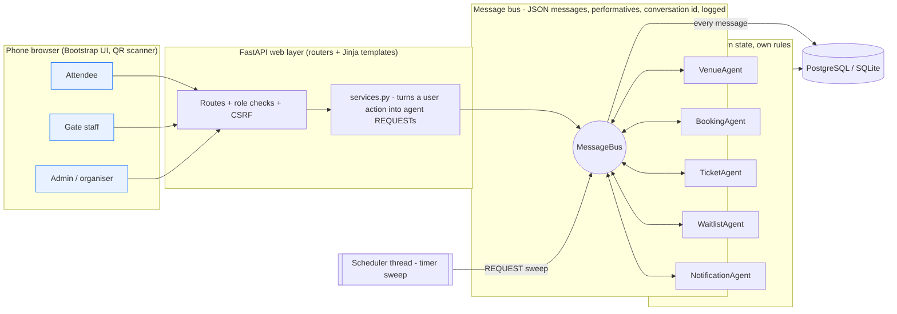
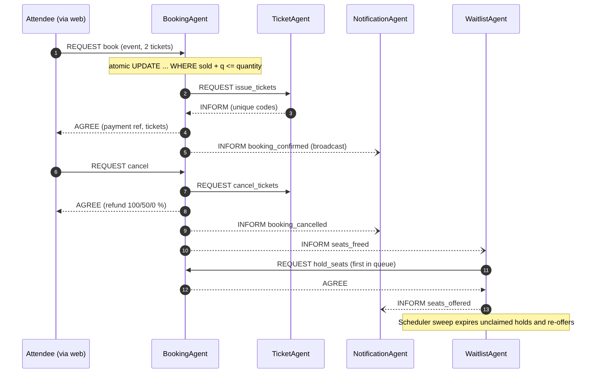

# 0. Submission details

| Item | Value |
|---|---|
| Student | `<YOUR NAME>` · `<YOUR INDEX NUMBER>` |
| Live URL (public HTTPS) | `<PUT YOUR RENDER URL HERE>` |
| GitHub repository | `<PUT YOUR GITHUB REPOSITORY URL HERE>` (lecturer added as collaborator if private) |
| README | In the repository root: how to run, environment variables, demo accounts, how to run tests |

**Demo accounts**

| Role | Email | Password |
|---|---|---|
| Admin | `admin@eventsphere.demo` | `<DEMO_PASSWORD you set on Render>` |
| Gate staff | `staff@eventsphere.demo` | same |
| Attendee | `attendee@eventsphere.demo` | same |

Payments are simulated. No bank, card or gateway is used and no card details are ever collected.

# 1. Overview

EventSphere lets a university publish events and hire its venues. Attendees book tickets from a phone browser and walk in
with a QR code; gate staff scan the codes; admins manage venues, events, hire requests and watch sales. Every *decision*
(accept a time slot, sell a ticket, refund, admit at the door, pass a freed seat to someone, notify a person) is taken by
one of five software agents. The web layer only turns a user action into a message and shows the agent's answer.

**Technology.** Python 3.12, FastAPI, Pydantic v2, PostgreSQL in production (SQLite locally), Jinja2 + Bootstrap 5 (works at 375 px),
`qrcode` for QR images, `html5-qrcode` in the browser for scanning, Chart.js for dashboard charts, Pytest, GitHub Actions CI, Render hosting.

# 2. Architecture

{ width=100% }

* **Web layer** (`app/routers`, `app/templates`): authentication, role checks, CSRF protection, forms. It never decides
  business questions; `app/services.py` converts a user action into a REQUEST message.
* **Message bus** (`app/bus.py`): validates every message with Pydantic, delivers it to the receiving agent, logs the message
  **and** the reply to the `messages` table with its `conversation_id`. Broadcast INFORM messages are delivered to all other agents.
* **Agents** (`app/agents`): each has a goal, its own state in the database, and documented rules. They import only the bus
  and `rules.py` – never each other (an automated test checks this).
* **Scheduler** (`app/system.py`): a background thread that sends `REQUEST sweep` to the WaitlistAgent every 30 s (proactive behaviour).

## 2.1 Message protocol

Every message is JSON with `id, conversation_id, sender, receiver, performative, content, in_reply_to`.
Performatives: `REQUEST, AGREE, REFUSE, PROPOSE, INFORM, FAILURE`. A `REFUSE` always has a human-readable `reason`; a `PROPOSE`
carries `reason` and a non-empty `options` list (alternative times / venues).

Real trace of one booking (admin dashboard → Agent messages, conversation `conv-…`):

| # | Sender → Receiver | Performative | Content (shortened) |
|---|---|---|---|
| 1 | WebUI → BookingAgent | REQUEST | `{"action":"book","user_id":2,"event_id":1,"items":[{"category_id":1,"qty":2}]}` |
| 2 | BookingAgent → TicketAgent | REQUEST | `{"action":"issue_tickets","booking_id":1,"items":[{"category_id":1,"qty":2}]}` |
| 3 | TicketAgent → BookingAgent | INFORM | `{"codes":["S8JO…","52-A…"],"count":2}` |
| 4 | BookingAgent → ALL | INFORM | `{"event":"booking_confirmed","booking_id":1,"total":2000.0,"payment_ref":"SIM-9EA997CB82"}` |
| 5 | BookingAgent → WebUI | AGREE | `{"booking_id":1,"payment_ref":"SIM-9EA997CB82","total":2000.0,"count":2}` |

{ width=95% }

# 3. Data model

Tables: `users, venues, events, ticket_categories, bookings, tickets, waitlist, hire_requests, calendar_slots, notifications,
messages, agent_state`. Passwords are stored as salted PBKDF2-SHA256 hashes. `ticket_categories` has a database CHECK
`0 <= sold <= quantity` as a second safety net. `agent_state(agent, state_key, state_value)` stores each agent's persistent *beliefs*.
Times are stored as ISO text in venue-local time (UTC+05:30 by default, `TZ_OFFSET_MINUTES`).

# 4. Part B – Agents and their decision rules

All numeric thresholds are constants in `app/rules.py`.

## 4.1 VenueAgent – goal: keep every venue's calendar free of clashes
*State:* `calendar_slots` (every confirmed or held activity per venue), `hire_requests`. *Talks to:* NotificationAgent (broadcasts).

| Rule | Decision |
|---|---|
| V1 | Refuse a slot if end ≤ start or the venue does not exist |
| V2 | Refuse an event whose total tickets exceed the venue capacity (requirement 3c) |
| V3 | Refuse a slot overlapping another activity; a **30-minute turnaround buffer** is applied before and after. The refusal names the clashing activity and **proposes free alternative slots** |
| V4 | Private hire is refused if: venue not open for hire; guests < 1; duration outside 1–12 h; less than 2 h notice; more than 180 days ahead |
| V5 | Hire with too many guests or a clash is answered with **PROPOSE**: alternative times at the same venue and other venues that fit, each with a price |
| V6 | A *routine* hire (≤ 6 h, ≤ 80 % of capacity, inside 08:00–22:00) is **confirmed automatically**; anything else is **escalated** to the admin and the time is held meanwhile |
| V7 | Price = hourly rate × hours, **+25 % on weekends**, **+10 % for evening starts (≥ 18:00)** (Part C: peak pricing) |
| V8 | Admin approval turns a held slot into a confirmed one; rejection releases it |

## 4.2 BookingAgent – goal: sell tickets fairly without overselling
*State:* seat counters (`sold`), bookings, payment/refund references, belief counters. *Talks to:* TicketAgent, WaitlistAgent, NotificationAgent.

| Rule | Decision |
|---|---|
| B1 | Refuse unless the event is published and has not started |
| B2 | Refuse more than **6 tickets** in one booking and more than **10 per person per event** (fairness) |
| B3 | Refuse a ticket category that does not belong to the event |
| B4 | Refuse (with the number left and a waitlist hint) when a category cannot cover the request – counting is one atomic SQL statement (section 6) |
| B5 | Payment is simulated; a payment reference `SIM-…` is recorded; if the simulated payment fails the seats are rolled back (FAILURE) |
| B6 | Refund on cancellation: **100 %** if ≥ 7 days before the event, **50 %** if ≥ 48 hours, otherwise **0 %**; refused after the event started or if a ticket was already used |
| B7 | If the organiser cancels an event, **every** confirmed booking is refunded 100 % and all tickets are cancelled |
| B8 | Seat holds for the waitlist (`hold_seats`, `release_hold`) are counted as unavailable to everyone else |

## 4.3 TicketAgent – goal: admit each ticket exactly once
*State:* tickets and belief `scan:<code>` (attempts, rejected, flagged). *Talks to:* BookingAgent.

| Rule | Decision |
|---|---|
| T1 | Every ticket gets a unique unguessable code (`secrets.token_urlsafe`, 144 bits); shown as a QR code |
| T2 | Unknown code → REFUSE `unknown` |
| T3 | Ticket belongs to another event → REFUSE `wrong_event` |
| T4 | Ticket (or event) cancelled → REFUSE `cancelled` |
| T5 | Ticket already used → REFUSE `already_used` (shows when it was admitted) |
| T6 | Before doors open (2 h before start) or after the event ended → REFUSE `outside_window` |
| T7 | Otherwise admit with **one atomic UPDATE** (`valid → used`) so two scanners cannot admit the same ticket |
| T8 | After 2 rejected re-scans the ticket is flagged **suspicious** (possible shared screenshot) and admins are notified; the belief survives restarts |

## 4.4 WaitlistAgent – goal: pass freed seats to waiting customers
*State:* `waitlist` entries with `offered_at` / `expires_at`. *Talks to:* BookingAgent, NotificationAgent. *Reactive:* listens to broadcast `seats_freed` and `event_cancelled`. *Proactive:* timer sweep.

| Rule | Decision |
|---|---|
| W1 | A person may join only when the category cannot cover what they want (otherwise REFUSE "book directly"); 1–6 tickets; one active entry per category |
| W2 | Freed seats are offered **first come, first served**; if the first person needs more seats than are free, the next person who fits gets them and the first keeps their place |
| W3 | An offer **holds** the seats (through BookingAgent) for 10 minutes; the UI shows a live countdown |
| W4 | **Timer:** the scheduler's `sweep` expires unclaimed holds, releases the seats and **re-offers** them to the next person – with no user action |
| W5 | A claim after expiry is refused even if the sweep has not run yet; claim and expiry cannot both win (atomic status update) |
| W6 | When an event is cancelled all waiting entries and holds are cleared |

## 4.5 NotificationAgent – goal: tell the right person what affects them
*State:* `notifications`. A pure **reactive listener** of broadcast INFORM events.

| Rule | Decision |
|---|---|
| N1 | `booking_confirmed`, `booking_cancelled` → the attendee (with refund amount) |
| N2 | `event_cancelled`, `waitlist_cleared` → every affected attendee |
| N3 | `seats_offered`, `hold_expired` → the waiting attendee |
| N4 | `hire_decided` → the person who requested the hire |
| N5 | `hire_escalated`, `suspicious_scan` → every admin |

## 4.6 Compliance with the agent rules (section 4.2 of the brief)

1. **Messages, not method calls** – agents only use `self.ask()` / `self.announce()` which go through the bus; `test_agents_never_import_or_call_each_other` scans the source.
2. **Reasons with every refusal** – `REFUSE` and `PROPOSE` require a reason; `test_every_refusal_carries_a_reason`.
3. **Persistent state** – `agent_state` and agent-owned tables; `test_agent_beliefs_persist_across_restart`.
4. **Reactive and proactive** – Notification/Booking/Waitlist react to broadcasts; the WaitlistAgent sweep runs on a timer.
5. **Traceability** – every message and reply is logged with its conversation id; Admin → Agent messages can follow one conversation across agents.
6. **Documented rules** – this section and `app/rules.py`.

# 5. Part A – requirement checklist

| Req. | Implementation |
|---|---|
| 1 Accounts and roles | Register/sign-in; PBKDF2 hashes; roles admin / staff / attendee; `role_required` dependency on every admin and scanner route (403 otherwise) |
| 2 Venues | Admin create/edit with name, location, capacity, description, image URL, hourly rate, open-for-hire flag |
| 3 Events | Create with ≥ 1 ticket category; draft / publish / cancel; capacity and overlap rules enforced by VenueAgent |
| 4 Browsing and booking | Mobile list with keyword + category filter (plus date/price/venue); tickets left per category; atomic booking; simulated payment reference; booking history; cancellation with stated refund policy |
| 5 Tickets and check-in | One unguessable QR per ticket; staff scanner with camera and manual fallback; admit once, clear rejection reasons |
| 6 Private hire | Immediate decision and price; routine auto-confirm; alternatives on refusal; admin approves/rejects escalations |
| 7 Dashboard | Tickets sold, revenue, check-ins, capacity per event, charts, and the readable agent message log |

# 6. Concurrency (no overselling)

Seat allocation is a **single atomic SQL statement** executed by the BookingAgent:

```sql
UPDATE ticket_categories SET sold = sold + :q WHERE id = :id AND sold + :q <= quantity
```

The database evaluates the condition and the increment together under a row lock. If two people book the last seat at the same moment, one
statement updates 1 row and the other updates 0 rows and receives a REFUSE ("only 0 left" + waitlist hint). A database CHECK constraint is
a second safety net. Admitting a ticket uses the same technique (`UPDATE tickets SET status='used' WHERE id=:id AND status='valid'`), and so do
waitlist claim/expiry. SQLite writers are serialised with a busy timeout; PostgreSQL uses row-level locks. `test_two_people_racing_for_the_last_seats_cannot_oversell`
starts parallel threads against the real database.

# 7. Security

* Passwords hashed with salted PBKDF2-SHA256 (200 000 iterations); never stored or logged in plain text.
* Role check on every admin and staff route; ticket pages and QR images are only served to the ticket owner.
* CSRF: a random token per session is required on every POST form and in the `X-CSRF-Token` header of the scanner's AJAX call.
* Session cookie is signed, HttpOnly, SameSite=Lax, Secure on HTTPS. Session is renewed at login (prevents session fixation).
* No secrets in Git: `SECRET_KEY`, `DATABASE_URL`, `DEMO_PASSWORD`, `AGENT_API_KEY` come from environment variables; `.env` is git-ignored.
* Parameterised SQL everywhere (no string-built values); Jinja2 auto-escaping against XSS; Pydantic validates all form input.
* The agent HTTP inbox is disabled unless `AGENT_API_KEY` is set or an admin session with CSRF header is used.

# 8. Part C – advanced features implemented

| Feature | Where |
|---|---|
| Waitlist with timed seat holds, visible countdown, automatic re-offer | WaitlistAgent W1–W6; *My tickets* page |
| Weekend / peak-time hire pricing decided by VenueAgent | V7 |
| Suspicious repeated-scan detection | TicketAgent T8 |
| Agents reachable over HTTP | `POST /agents/{name}/inbox` (documented in `/docs`), `GET /agents` |
| Charts on the dashboard | Tickets sold per event, check-ins per hour (Chart.js) |
| Advanced search | Date range, price range, venue, category, keyword |

# 9. Testing

`pytest` runs about 50 tests (all passing). Highlights:

| Area | Tests |
|---|---|
| Overbooking | never sells more than exists; parallel race for the last seats |
| Double check-in | ticket admitted once only; second scan rejected; suspicious flag |
| VenueAgent | overlap + buffer; capacity; routine hire confirmed with weekend price; escalation and approval; clash → PROPOSE; refusals with reasons |
| BookingAgent | quantity limits; draft/started events; payment failure rolls back; refund tiers; cancelling twice; organiser cancellation refunds everyone |
| TicketAgent | unique codes; wrong event; cancelled/unknown; check-in time window |
| WaitlistAgent | cannot join while seats exist; FCFS offer with hold; claim; **timer sweep expires and re-offers**; expired claim refused; event cancellation clears list |
| NotificationAgent | attendee and admin notified from broadcasts |
| Messaging | conversation traceable across agents; every refusal has a reason; beliefs survive restart; agents never call each other |
| Web layer | role checks (403 / redirect), CSRF rejection, register → book → cancel flow, ticket privacy, scanner API, hire flow, admin CRUD, agent inbox |

# 10. Deployment

Render Blueprint (`render.yaml`): one Python web service (`uvicorn app.asgi:app`) and one PostgreSQL database; HTTPS is provided by Render.
`DATABASE_URL` switches the data layer from SQLite to PostgreSQL without code changes. The health check is `/healthz`. The free tier sleeps
after inactivity, so the site is opened before the viva.

# 11. Limitations and future work

* Single-process message bus (in-memory delivery, durable log): enough for one web worker; a broker such as Redis/RabbitMQ would be needed to scale out.
* Email notifications are not implemented (in-app notifications only).
* Venue images are URLs (free hosting has no persistent disk for uploads).
* Time zone is a fixed offset instead of full daylight-saving handling.
